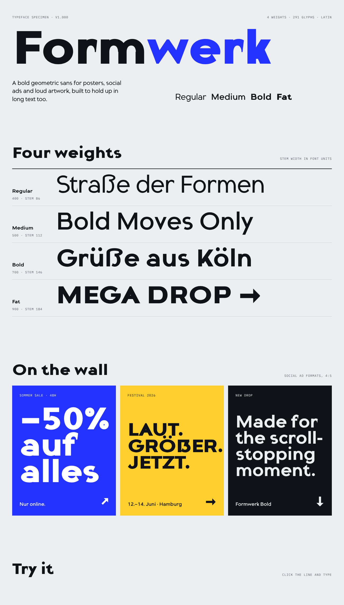

# Formwerk

**Formwerk** is a bold, modern geometric sans serif made for posters, social ads and loud artwork, with an x-height and apertures that keep it readable in running text.



## Weights

| Style   | Weight class | Stem (units) | Use |
|---------|-------------:|-------------:|-----|
| Regular | 400 | 86  | Body text, captions |
| Medium  | 500 | 112 | UI, subheads, small text on images |
| Bold    | 700 | 146 | Headlines |
| Fat     | 900 | 184 | Posters, social ads, display |

## What makes it Formwerk

- **Geometric construction:** bowls are superellipses, a touch squarer than a true circle, which gives the solid, modern feel of fonts like Gilroy or Futura.
- **Notched joints:** arches and bowls leave the stems through a thin, crisp notch (n, m, h, b, d, p, q, u, a). The heavy weights keep open counters, and the notches act like ink traps at small sizes.
- **Angled terminals:** c, e, s, a, f, t, j, g, r end in slanted cuts, halfway between radial and vertical.
- **Signature details:** a diagonally sliced `t`, a flat-topped `3`, a straight-tailed `Q`, round dots, and a geometric `ß` and capital `ẞ`.
- **Display extras:** arrows `→ ← ↑ ↓ ↗ ↘`, solid-head arrows for ads, and tabular figures that line up in prices and dates.

## Character set (281 characters per weight)

- `A–Z`, `a–z`, `0–9` (tabular lining figures)
- German: `Ä Ö Ü ä ö ü ß ẞ`
- Western European: `À Á Â Ã Å Æ Ç È É Ê Ë Ì Í Î Ï Ð Ñ Ò Ó Ô Õ Ø Œ Ù Ú Û Ý Þ Ÿ` and their lowercase forms
- Central European and Turkish: `Č Ć Ď Ě Ğ İ ı Ł Ń Ň Ő Ř Ś Ş Š Ť Ů Ű Ź Ż Ž`, macrons, breves and more
- Punctuation: `. , : ; … ! ? ¡ ¿ ' " ‘ ’ “ ” ‚ „ ‹ › « » - – — _ ( ) [ ] { } / \ | ¦ · •`
- Symbols: `@ # % & * § ¶ © ® ™ ° + − × ÷ = ± < > ^ ~ ¬ µ ª º ¹ ² ³ ½ ¼ ¾`
- Currency: `$ € £ ¥ ¢ ¤`

## OpenType features

- `kern`: automatic class kerning (AV, To, LT, T., “A and so on)
- `ss01` / `salt`: single-storey geometric `a`, including all accented forms

```css
.poster { font-family: "Formwerk"; font-weight: 900; font-feature-settings: "ss01" 1; }
```

## Files

```
fonts/otf/        Formwerk-{Regular,Medium,Bold,Fat}.otf    desktop (CFF outlines)
fonts/ttf/        Formwerk-{Regular,Medium,Bold,Fat}.ttf    desktop / apps (autohinted)
fonts/webfonts/   .woff2 and .woff                          web
specimen/         index.html (open in a browser), preview.png
source/           the Python sources that generate every glyph
```

To install on desktop, open the `.otf` files (macOS: Font Book, Windows: right-click → Install). In apps, Medium and Fat show up as separate families ("Formwerk Medium", "Formwerk Fat"). Apps that support typographic families group all four under "Formwerk".

### Web

```css
@font-face { font-family: "Formwerk"; font-weight: 400; src: url("Formwerk-Regular.woff2") format("woff2"); }
@font-face { font-family: "Formwerk"; font-weight: 500; src: url("Formwerk-Medium.woff2") format("woff2"); }
@font-face { font-family: "Formwerk"; font-weight: 700; src: url("Formwerk-Bold.woff2") format("woff2"); }
@font-face { font-family: "Formwerk"; font-weight: 900; src: url("Formwerk-Fat.woff2") format("woff2"); }
```

## Metrics

UPM 1000 · cap height 700 · x-height 520 · ascender 745 · descender −215

## Building from source

The fonts are generated parametrically. Every glyph is constructed from rectangles, superellipses and diagonal strokes that are merged with boolean operations, and all four weights come from the same code with different stem and width parameters (`source/params.py`).

```sh
pip install -r requirements.txt
python3 source/build.py            # all weights → fonts/
python3 source/build.py Bold       # a single weight
python3 source/specimen.py         # regenerate specimen/index.html
python3 source/sheet.py proof.png 120 "Hamburgefonstiv"   # quick multi-weight proof image
```

| File | Contents |
|------|----------|
| `source/geom.py` | primitives and boolean helpers |
| `source/params.py` | per-weight parameters (stems, metrics, spacing) |
| `source/lower.py`, `upper.py`, `figures.py`, `symbols.py`, `extra.py` | glyph construction |
| `source/accents.py` | diacritics and accented letters |
| `source/features.py` | kerning (from outline profiles) and `ss01` |
| `source/build.py` | font compilation (OTF, TTF, WOFF2, WOFF) |

## License

Formwerk is licensed under the [SIL Open Font License 1.1](OFL.txt). You can use it freely in personal and commercial work, and bundle or embed it.
